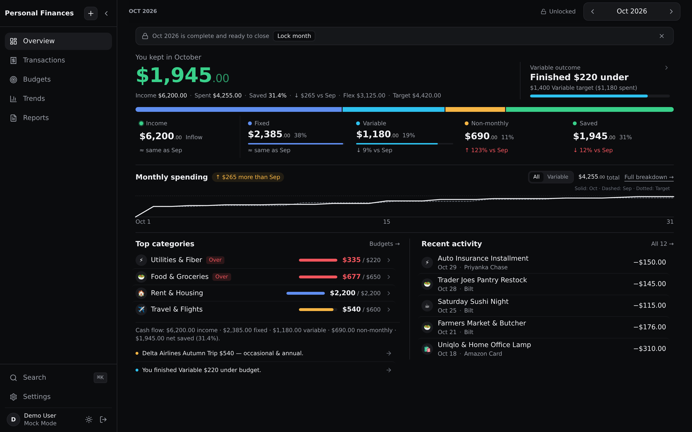
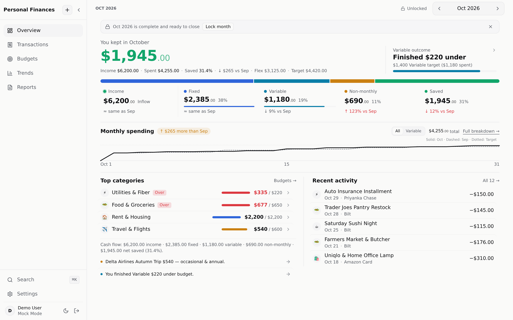
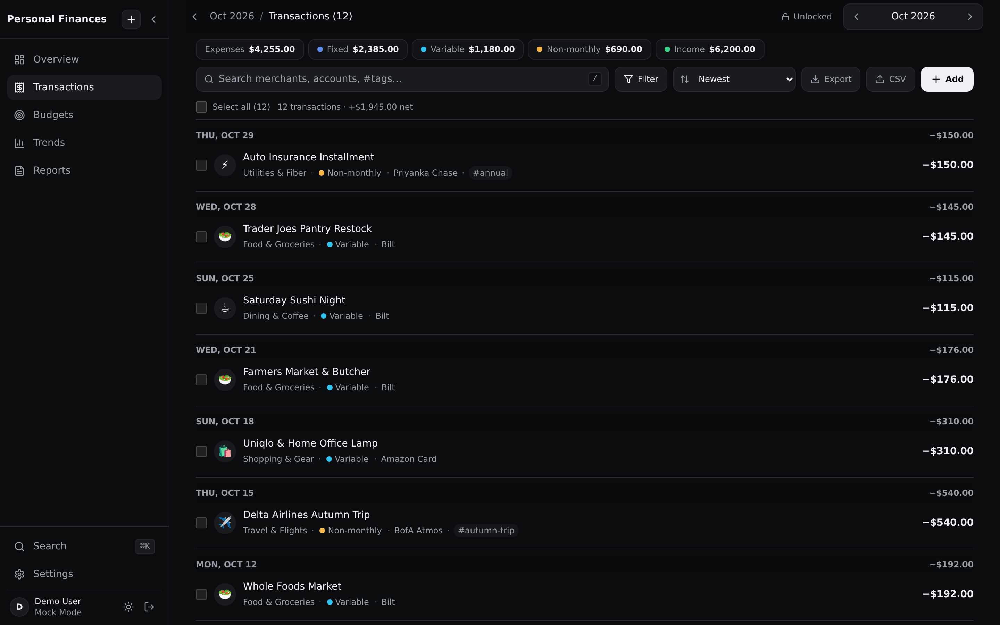
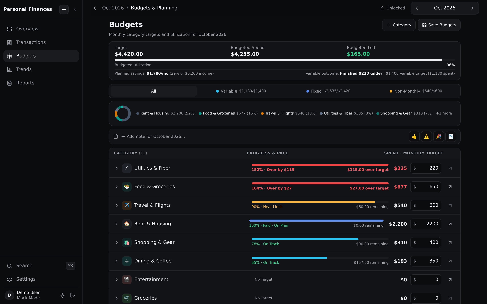
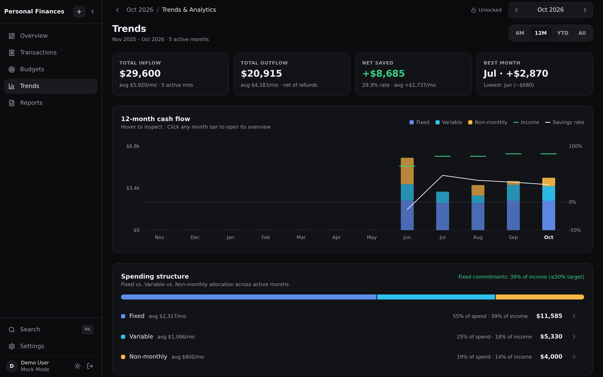
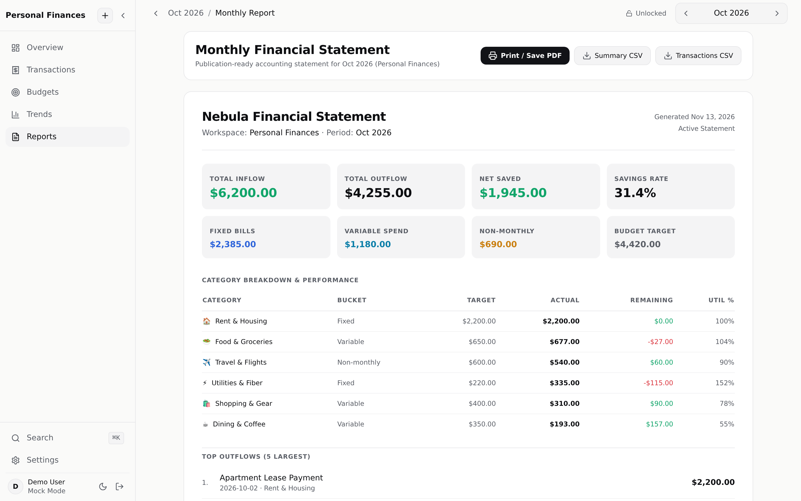
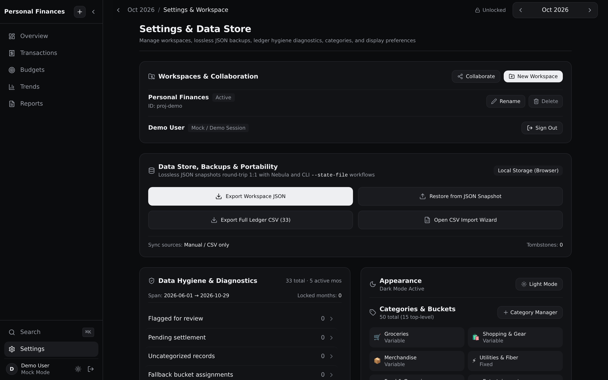
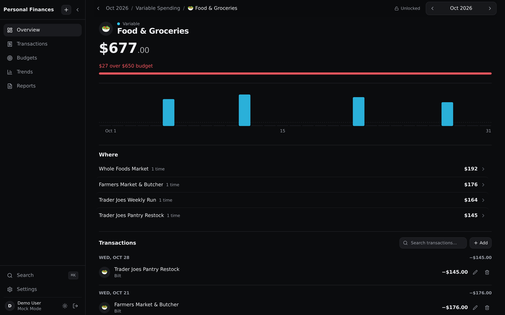
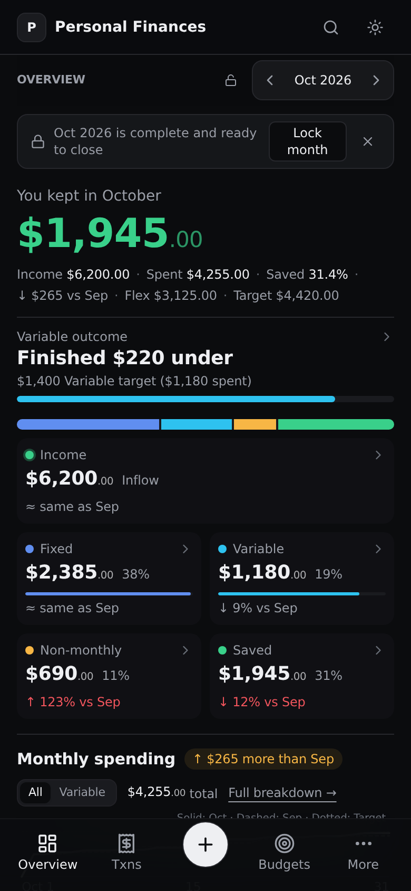
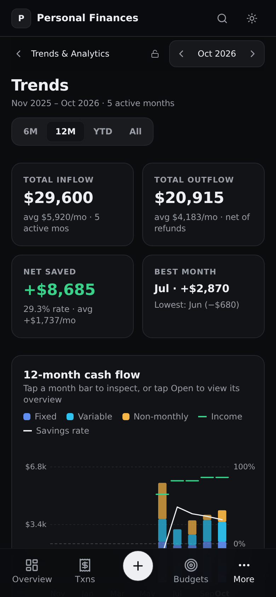

<div align="center">

# Nebula Expense Tracker

**A calm, serverless budgeting app. Your ledger lives in your own Google Sheet.**

Track spending month by month, plan budgets, see long-term trends and close each month with a print-ready statement. There is no backend and no database to run. Hand the data to your AI assistant through the bundled agent skills.

[**Live app →**](https://saimanoj01.github.io/expense/) · [Releases](https://github.com/saimanoj01/expense/releases) · [Agent skills](#-ai-via-agent-skills)



</div>

---

## ✨ Highlights

- **Your data, your Sheet.** Sign in with Google and each workspace is stored as a normal spreadsheet in your Drive (`Transactions`, `Categories`, `Budgets`, `Locks`, `Notes`). You can open it, share it or back it up like any other file.
- **Try it without an account.** Demo / Mock mode runs fully in the browser using `localStorage`.
- **Three spending buckets.** Each expense is **Fixed**, **Variable** or **Non-monthly**, so a one-off flight doesn't hide an overspent grocery budget.
- **Drill down from month to transaction.** Overview → bucket → category → individual transactions, all deep-linkable through the URL.
- **Month close-out.** Lock a finished month to protect its numbers, then print or export its statement.
- **Portable.** Lossless JSON snapshots, full ledger CSV export and a CSV import wizard with duplicate detection.
- **Keyboard-first and responsive.** Use `⌘K` / `Ctrl+K` for the command palette and `N` to add a transaction. Layouts are tuned for desktop, tablet and phones down to 320 px, in both dark and light themes.

## 📸 Tour

| | |
|---|---|
| **Overview.** What you kept this month, the bucket split, daily pace vs. last month, categories to watch and recent activity.  | **Transactions.** Ledger grouped by day with search, filters, `#tags`, bulk edit, inline category changes, CSV import/export and undo for deletes.  |
| **Budgets.** Monthly targets per category with pace, quick-fill presets, sub-category rollups and monthly notes.  | **Trends.** 6M / 12M / YTD / All views: KPI strip, stacked cash-flow chart with income and savings-rate overlays, spending structure and category drivers.  |
| **Reports.** A monthly financial statement you can print or save as PDF (always on white paper), plus summary and transaction CSVs.  | **Settings & Data Store.** Workspaces and sharing, JSON backup and restore, ledger export, data-hygiene checks and category management.  |
| **Category drilldown.** Daily spend bars, budget attribution and the transactions behind the number.  | **Mobile.** Bottom navigation, a large add button and full feature parity. <p align="center"> </p> |

## 🚀 Quick start

```bash
git clone https://github.com/saimanoj01/expense.git
cd expense
npm install
npm run dev          # http://localhost:3000
```

Pick **Try Demo Mode** on the sign-in screen to explore right away. Nothing leaves your browser.

### Connect Google (optional)

1. In Google Cloud Console, create an **OAuth 2.0 Client ID** (Web application).
   - Authorized JavaScript origins: `http://localhost:3000` and your deploy origin (e.g. `https://<user>.github.io`).
   - Enable the **Google Sheets API** and **Google Drive API**.
2. Copy `.env.example` to `.env` and fill it in:

| Variable | Required | Purpose |
|---|---|---|
| `VITE_GOOGLE_CLIENT_ID` | For Google sign-in | OAuth client used to read and write your workspace spreadsheets |
| `VITE_GEMINI_API_KEY` | No | Optional LLM fallback for auto-categorizing imported transactions |
| `VITE_BASE_PATH` | Deploy only | Base path for sub-path hosting (e.g. `/expense/`) |

The app requests the `drive.file`, `drive.readonly` and `spreadsheets` scopes. Your data only goes between your browser and Google.

## 🤖 AI via agent skills

Nebula has no AI built into the app. It is meant to be a **clean, well-structured data store**, and analysis is handed off to your AI agent through the skills in [`.agents/skills`](.agents/skills):

| Skill | What it does |
|---|---|
| [`expense-ingest`](.agents/skills/expense-ingest/SKILL.md) | Imports transactions from bank/card syncs, CSVs, receipts or plain language. Handles deduplication, pending → settled upgrades, multi-item splits and 3-stage categorization. |
| [`expense-qna`](.agents/skills/expense-qna/SKILL.md) | Answers questions about your spending, budgets, savings and trends using a structured export of your ledger. |

Both skills work with the live Google Sheet or with an offline **workspace JSON snapshot** (Settings → *Export Workspace JSON*):

```bash
python3 .agents/skills/expense-qna/scripts/export_expense_context.py \
  --state-file ./nebula-workspace.json --month 2026-10 --scope quarter --redact
```

## 🧱 Tech stack

React 18 · TypeScript · Vite 5 · Tailwind CSS 3 · Framer Motion · Lucide icons. Charts are hand-built SVG. Tests use Playwright and `node:test`.

```
src/
├── components/   views/, overview/, dashboard/ (drilldowns), transactions/,
│                 budgets/, trends/, modals/, layout/, common/
├── context/      AppContext (ledger state), AuthContext (Google / Mock)
├── services/     storage.ts (Sheets + localStorage adapters), ingestion/, ai/
├── hooks/        useTransactions, useCsvImport, useNavigation, …
└── utils/        trendsAnalytics, workspacePortability, navigation, …
```

## 🧪 Testing

```bash
npm run lint         # ESLint
npm run build        # Type-check and production build
npm run test:unit    # Unit tests (node:test)
npx playwright test -c tests/playwright.config.ts --project=chromium   # E2E (tier1–tier17)
```

To regenerate the README screenshots, run `node scripts/capture-readme-screenshots.mjs` (set `CHROMIUM_PATH` to use a system Chromium).

## 🌐 Deployment

Every push to `main` builds and deploys to **GitHub Pages** through [`.github/workflows/deploy.yml`](.github/workflows/deploy.yml). Add `VITE_GOOGLE_CLIENT_ID` as a repository secret to enable Google sign-in on the deployed site.

## 🗺️ Changelog

See [Releases](https://github.com/saimanoj01/expense/releases). **v1.0.0** is the first stable release.
